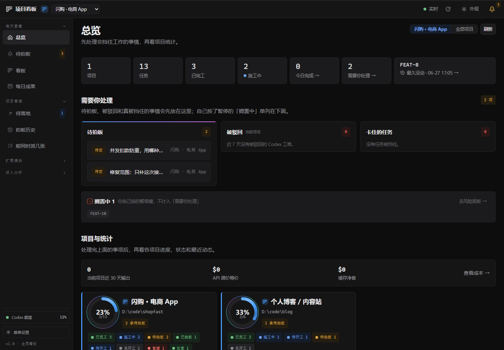
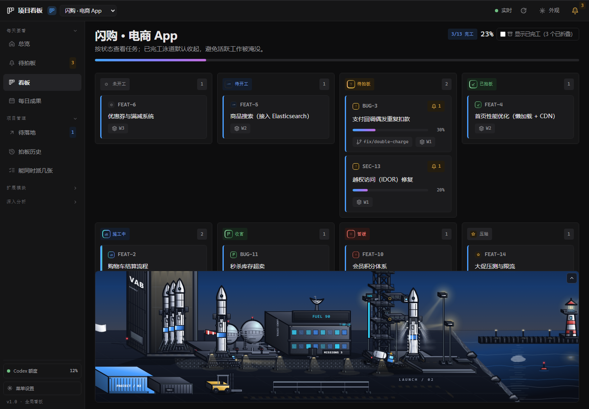
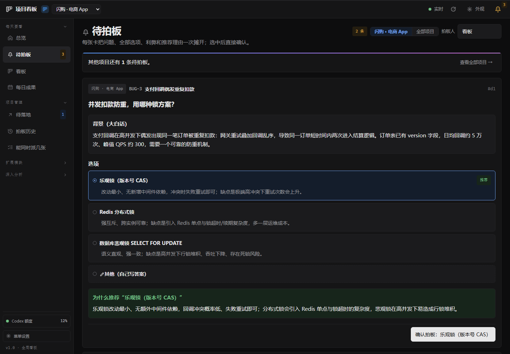
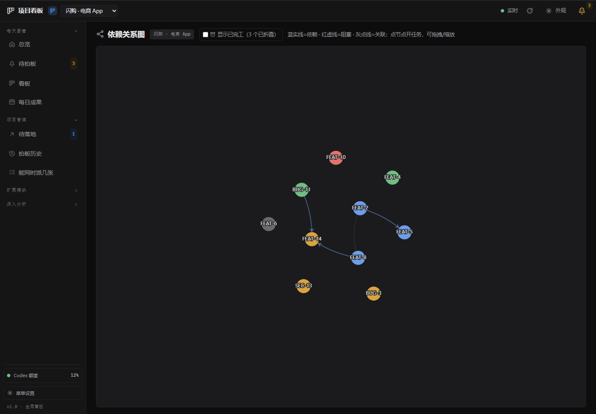
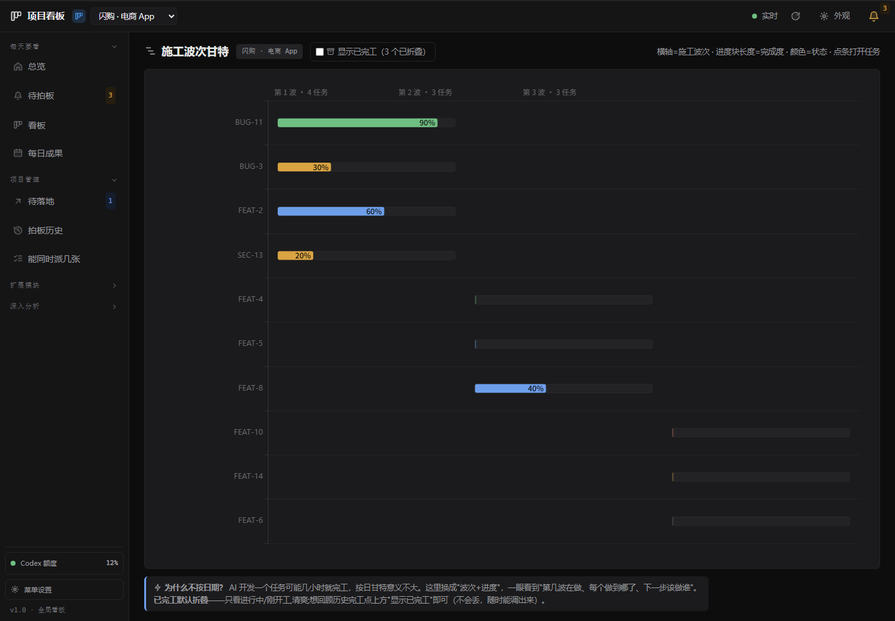

<div align="center">

# 🗂️ 项目管理看板 · Project Dashboard

**给「AI 干活」用的项目看板——AI 自己更新进度，你只在岔路口拍板。**

*An AI-native project board: your AI agents update it, you just approve the forks.*

[English README](README.en.md)

一个默认**本地运行、双击即用**，也可在自己的服务器部署的多项目看板。你把任务派给 AI（Claude Code / Cursor / Codex / Gemini …），
AI 一路把「认领 → 进度 → 待拍板 → 完工」写回看板；你只负责**看进度**和**在关键岔路口拍板**。

显式启用协作模式后，负责人可分发邀请链接或邀请码，管理成员的项目权限；成员注册登录后，只能查看获授权的项目、领取空闲任务并更新自己的进度。服务器由部署者自行准备，见[自部署说明](docs/self-hosting.md)。

</div>



---

## 💡 它和别的看板/工具，到底哪不一样？

市面上的 AI 工具大多在做「**让 AI 替你干活**」（帮你跑 agent、并行、发 PR）。
传统看板（Jira / Trello）则要**你手动挪卡、改状态**。

**这个东西站在中间的空档：它是「AI 的监工台 + 决策台」——**

> 🤖 **AI 建链、AI 更新**：任务的状态/进度/决策由 AI 经命令行写回，你**不用手动挪一张卡**。
> 🙋 **你只做三件事**：看进度、在岔路口拍板、把新活派给 AI。
> 🧭 **这正是它区别于传统敏捷看板的地方**——不是让你更勤快地维护看板，而是让你**根本不用维护它**。

如果你完全不接 AI、只想用鼠标手动管任务，那你要的是传统看板，不是它。

---

## ✨ 亮点

- 🧠 **AI 原生**：看板是 AI 汇报进度的「权威账本」，不是给人填的表格。
- ✅ **拍板闭环**：AI 遇到岔路口 → 摆出选项 + 推荐 + 利弊 → 你一键拍板 → 追踪到「是否落地」。
- 🗂️ **多项目一屏**：手里几个项目，谁做到哪、卡在哪、有啥等你拿主意，一眼看全。
- 🖥️ **默认本机运行**：默认监听 `127.0.0.1`；协作模式由你在自己的服务器显式启用，数据留在自己的持久化目录。
- 👥 **邀请协作**：负责人分配项目权限，成员领取任务和回写本人进度；负责人可主动信任自己的浏览器，减少重复登录。
- 📦 **双击即用**：Windows 一键安装包，内嵌运行时，**不用装 Node、不用碰命令行**。
- 🔌 **跨模型**：Claude Code 开箱即用；Cursor / Codex / Gemini / Copilot / 任何能跑命令的工具都能接（见下）。
- 📊 **20 个视图**：总览、看板、待拍板、依赖图、波次甘特、风险、占用冲突、验收、活动流…（含默认关闭的扩展模块）
- ⚡ **实时刷新**：AI 一有进展，页面几秒内自动更新，变化的卡片黄色闪一下。

---

## 📸 截图

**看板：AI 干到哪、卡在哪，一眼看全**



**待拍板中心：AI 摆出选项 + 推荐 + 每项利弊，你一键拍板**



<details>
<summary>📂 更多视图（依赖图 / 波次甘特）</summary>





</details>

---

## 🚀 快速开始

### 方式 A：一键安装包（推荐，零门槛）

1. 到 [**Releases**](../../releases/latest) 下载 `ProjectDashboard-Setup-vX.X.X.exe`。
2. 双击安装（首次运行 Windows 可能提示 SmartScreen → 点「更多信息」→「仍要运行」；未签名，正常现象）。
3. 桌面/开始菜单出现「项目管理看板」，双击启动 → 浏览器自动打开。
4. 第一次是空的？双击「**添加项目**」把你的项目文件夹加进来。
5. 之后让你的 AI（如 Claude Code）在这个项目里干活即可——它会自动把进度写进看板。

> 内嵌 Node 运行时，**无需预装 Node.js、无需联网**。约 22MB，per-user 安装（不需要管理员权限）。

### 方式 B：从源码跑（开发者）

需要 Node.js 24。

```bash
git clone https://github.com/TPP2002/project-dashboard.git
cd project-dashboard
npm ci
npm --prefix web ci
npm --prefix web run build                               # 构建前端
node server/server.cjs                                    # 起服务（自动开浏览器）
```

构建好前端后，也可运行 `npm run demo`：用两个虚构项目在临时目录启动演示实例，端口从 6099 起，不碰真实看板；按 Ctrl+C 退出。

### 方式 C：自己的服务器＋Docker Compose

按[自部署说明](docs/self-hosting.md)准备数据目录、创建负责人并启动协作模式。先通过 SSH 隧道私有验证，再配置实际访问地址与 HTTPS。默认只发布服务器回环端口，没有默认账号或开放注册。

云端调度是可选组件，Windows 节点通过出站 SSH 接单。真实 Linux 与 Windows 单节点的任务执行、重复请求和云端重启恢复已完成隔离验证；真实双机负载分配及正式调度迁移仍在联调。不要把启动网页当作已迁移底层调度，已有部署按[迁移契约](docs/plans/cloud-collaboration/scheduler-migration.md)切换。

### 扩展模块

Codex 面板、成本、算力、审阅台是负责人个人工作流用的四个扩展模块，**默认关闭**。默认「每天要看」只保留总览、待拍板、看板、每日成果。

在侧栏底部的「菜单设置 → 扩展模块」打开所需模块，或在 `DASHBOARD_HOME/settings.json` 中设置 `modules`，例如 `{"modules":{"codex":true}}`。关闭时侧栏隐藏入口、直接访问页面跳回总览，对应接口返回 404；重新开启会保留原有菜单分组。Codex 工单随顶栏当前项目读取代码仓。

启动前还可设置 `DASHBOARD_MODULES=codex,cost`，或设为 `all` 全开；环境变量优先于设置文件和菜单开关。演示实例使用 `all`。设置文件位置与详细说明见[使用手册的扩展模块一节](docs/看板使用手册.md#十二扩展模块)。

---

## 🤖 支持哪些 AI / 模型？

**看板本体与模型完全无关**：任何能执行一条命令的东西（AI、脚本、甚至你自己）都能更新它——
核心是让施工方运行 `node cli/index.cjs claim / progress / done …` 把状态写回。

| 工具 | 接入方式 |
|---|---|
| **Claude Code** | ✅ 开箱即用（读 `CLAUDE.md` 协议 + git hook 自动同步 + 未认领拦提交的闸门） |
| **Cursor / Codex / Gemini CLI / Copilot** | 给它一份「家规」文件即可（`.cursor/rules`、`AGENTS.md`、`GEMINI.md`、`copilot-instructions.md`），告诉它「动代码前先 `cli claim`、干完 `cli done`」。模板见 [`AGENTS.md`](AGENTS.md) 与 [接入其它 AI 模型](docs/接入其它AI模型.md) |
| **任何能跑 shell 的 agent / 脚本** | 直接调 CLI 即可 |

> 补充：`post-commit` / `pre-commit` 等 **git 钩子天然跨工具**（谁提交都触发），
> 所以「提交自动同步」和「没认领就拦提交」这两条对所有工具都生效。

---

## 🧭 定位边界（是什么 / 不是什么）

- ✅ **是**：AI 驱动开发的**监工台 + 决策台**，支持默认本机模式和显式启用的自部署协作模式。
- ✅ **协作范围**：邀请注册、项目授权、领取任务、本人进度，以及负责人的成员和设备管理。
- ❌ **不提供**托管 SaaS；使用者自行准备和维护服务器。评论、通知和原生移动端不在当前协作范围内。
- AI 经 CLI 更新施工记录；协作成员可在网页领取并更新自己的任务，审批和调度管理仍由负责人掌握。

---

## 📖 深入了解

- 📘 [**产品手册（PDF）**](docs/产品手册-PRODUCT-MANUAL.pdf)｜[Markdown 版](docs/产品手册-PRODUCT-MANUAL.md) — 架构、数据模型、CLI 全集、关键设计决策+为什么、边界。
- 📗 [使用手册（大白话图文）](docs/看板使用手册.md) — 教你看懂每一屏、怎么在网页上拍板。
- 🔌 [接入其它 AI 模型](docs/接入其它AI模型.md) — 让 Cursor / Codex / Gemini / Copilot 也能开箱接入。

### CLI 常用命令（`node cli/index.cjs <命令> --project <id>`）

| 命令 | 用途 |
|---|---|
| `register --id --name --root` | 注册项目 |
| `claim <id> --branch` | 认领任务 → 施工中 |
| `progress <id> --percent` | 回写进度 |
| `pending <id> --q --opt… --rec` | 登记待拍板问题 |
| `decide <id> --did --answer` | 拍板；答完最后一条决策自动 待拍板→已拍板（`--no-promote` 可留在待拍板） |
| `done <id> [--pr --commit]` | 完工 |
| `list` / `show <id>｜--pending` | 查询 / 待拍板中心 |
| `hooks-install --project <id>` | 给项目装 git hook（自动同步 + 未认领拦提交）；hook 指向**发布副本**，不指向看板检出 |
| `release` | 把主干最新代码导出成发布副本 `~/.claude/dashboard-release`（看板代码合进主干后跑一次即生效） |

---

## 🔒 隐私与安全

- 只绑 `127.0.0.1`，**仅本机访问**；不联网、不上传任何数据。
- 数据只存在本地（项目列表 + 各项目 `.dashboard/board.json`）。
- 读文档接口有路径越界防御；网页写操作只有「拍板」一项，且经校验。

---

## 📄 许可与致谢

- 安装包内嵌 [Node.js](https://nodejs.org)（MIT）作为运行时，详见安装目录内 `NOTICE-第三方声明.txt`。
- 许可证：[MIT](LICENSE)。可自行部署、修改和分发；第三方组件仍遵循各自许可证。

<div align="center">

**AI 干活，你拍板。** 🗂️

</div>
